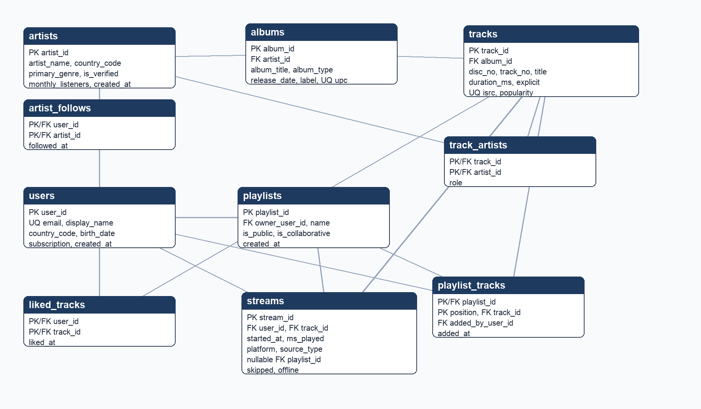
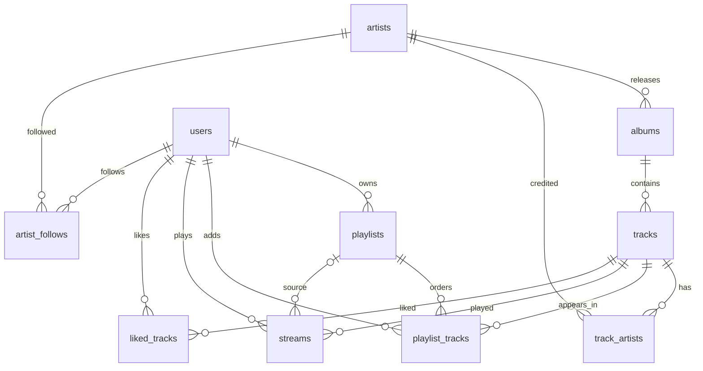

# Schema design

PostgreSQL 15+. Run from the repository root: `unzip -q seed_data.zip`, then `psql -v ON_ERROR_STOP=1 -d YOUR_DB -f sql/01_schema.sql` and `psql -v ON_ERROR_STOP=1 -d YOUR_DB -f sql/02_load_data.sql`. The load uses `\copy` and finishes with `ANALYZE`. No tuning indexes are created. PostgreSQL creates indexes for every primary key and unique constraint listed below.

## Data dictionary

`PK` means primary key, `FK` foreign key, `UQ` unique, `NN` not null. All columns below retain the exact CSV names. IDs are integer except `stream_id`, which is bigint to allow growth and the workload's high test ID. Times use `timestamptz` to preserve the instant encoded with an offset. `text` names and labels have no justified maximum length.

| Table | Columns, type, and constraint | Reason |
|---|---|---|
| artists | `artist_id integer PK`; `artist_name text NN`; `country_code char(2) NN CHECK`; `primary_genre text NN`; `is_verified boolean NN`; `monthly_listeners integer NN CHECK >=0`; `created_at timestamptz NN` | Artist identity, profile, country format, nonnegative snapshot |
| albums | `album_id integer PK`; `artist_id integer NN FK`; `album_title text NN`; `album_type text NN CHECK enum`; `release_date date NN`; `label text NN`; `upc char(12) NN UQ CHECK digits` | One releasing artist; UPC is a candidate key |
| tracks | `track_id integer PK`; `album_id integer NN FK`; `disc_no smallint NN CHECK >=1`; `track_no smallint NN CHECK >=1`; `title text NN`; `duration_ms integer NN CHECK >0`; `explicit boolean NN`; `isrc char(12) NN UQ CHECK format`; `popularity smallint NN CHECK 0–100`; `UQ(album_id,disc_no,track_no)` | Recording identity, album slot, valid duration and popularity |
| track_artists | `track_id integer NN FK`; `artist_id integer NN FK`; `role text NN CHECK enum`; `PK(track_id,artist_id)` | One credit per artist per track; role is primary or featured |
| users | `user_id integer PK`; `email text NN UQ CHECK format`; `display_name text NN`; `country_code char(2) NN CHECK`; `birth_date date NN CHECK >=1900-01-01`; `subscription text NN CHECK enum`; `created_at timestamptz NN` | User identity, login candidate key, valid profile categories |
| playlists | `playlist_id integer PK`; `owner_user_id integer NN FK`; `name text NN`; `is_public boolean NN`; `is_collaborative boolean NN`; `created_at timestamptz NN`; `CHECK NOT(public AND collaborative)` | Owned playlist; seed business rule forbids both flags |
| playlist_tracks | `playlist_id integer NN FK`; `position integer NN CHECK >=1`; `track_id integer NN FK`; `added_by_user_id integer NN FK`; `added_at timestamptz NN`; `PK(playlist_id,position)` | Ordered entries; the same track may occupy two positions |
| streams | `stream_id bigint PK`; `user_id integer NN FK`; `track_id integer NN FK`; `started_at timestamptz NN`; `ms_played integer NN CHECK >=0`; `platform text NN CHECK enum`; `source_type text NN CHECK enum`; `playlist_id integer nullable FK`; `skipped boolean NN`; `offline boolean NN DEFAULT false`; `CHECK(source_type='PLAYLIST' OR playlist_id IS NULL)`; `CHECK(NOT skipped OR ms_played<30000)` | Event history, source consistency, skip definition; playlist reference may be absent after deletion |
| liked_tracks | `user_id integer NN FK`; `track_id integer NN FK`; `liked_at timestamptz NN`; `PK(user_id,track_id)` | One current like per user and track |
| artist_follows | `user_id integer NN FK`; `artist_id integer NN FK`; `followed_at timestamptz NN`; `PK(user_id,artist_id)` | One current follow per user and artist |

The enum sets are explicit in the DDL. The seed uses album types `ALBUM`, `EP`, `SINGLE`, `COMPILATION`; subscriptions `FREE`, `PREMIUM`, `DUO`, `FAMILY`, `STUDENT`; platforms `ANDROID`, `CAR`, `DESKTOP`, `IOS`, `SPEAKER`, `WEB`; stream sources `ALBUM`, `ARTIST`, `PLAYLIST`, `RADIO`, `SEARCH`. All `CHECK` constraints accept the observed seed rows. The schema deliberately does not enforce cross-table assertions such as one `PRIMARY` credit per track, a matching album artist, or played milliseconds within track duration; ordinary table checks cannot express those safely without triggers.

## Relationships and deletes

Artists → albums and albums → tracks are 1:N and use `RESTRICT` to prevent accidental removal of released catalog. Artists ↔ tracks is M:N through `track_artists`; deleting a track cascades its credits, while deleting a credited artist is restricted. Users → playlists is 1:N with cascade, and playlists ↔ tracks is M:N through ordered `playlist_tracks`; playlist or track deletion removes entries, while deleting an adding user is restricted for attribution. Users ↔ tracks through `liked_tracks` and users ↔ artists through `artist_follows` are M:N with cascade on either endpoint. Users and tracks each have 1:N streams with `RESTRICT` to retain event history. A playlist has 0:N streams and its deletion sets the historical stream's `playlist_id` to null. That is why the stream check allows `PLAYLIST` with a null ID; in the seed every playlist-sourced stream has an ID.

## Dependencies and normal form

All columns are atomic (1NF). Each row's nonkey attributes depend on its whole key and no nonkey attribute determines another within the same relation, so the modeled relations are in BCNF, subject to the noted snapshots and cross-table redundancy. Candidate keys and material functional dependencies:

| Table | Functional dependencies |
|---|---|
| artists | `artist_id →` all other columns |
| albums | `album_id →` all other columns; `upc → album_id` and thus all columns |
| tracks | `track_id →` all other columns; `isrc → track_id`; `(album_id,disc_no,track_no) → track_id` |
| track_artists | `(track_id,artist_id) → role` |
| users | `user_id →` all other columns; `email → user_id` and thus all columns |
| playlists | `playlist_id →` all other columns |
| playlist_tracks | `(playlist_id,position) → track_id,added_by_user_id,added_at` |
| streams | `stream_id →` all other columns |
| liked_tracks | `(user_id,track_id) → liked_at` |
| artist_follows | `(user_id,artist_id) → followed_at` |

`artists.monthly_listeners` is a cached count derived from recent streams and credits; its time window is implicit and it can become stale. Keep it because the provided nightly update and artist profile use it, but document the refresh instant in production. `streams.skipped` correlates with `ms_played`, yet the data only establish `skipped ⇒ ms_played < 30000`, not the reverse; keep the explicit event flag. `albums.artist_id` and the primary `track_artists` credit agree for all seed rows but represent album ownership and recording credit, respectively; keep both. An event's `source_type='PLAYLIST'` is retained even if a referenced playlist is later deleted.

## Seed verification

CSV inspection of all 10 files gave these counts: `artists` 3,000; `albums` 12,000; `tracks` 67,808; `track_artists` 77,489; `users` 30,000; `playlists` 10,000; `playlist_tracks` 120,004; `streams` 250,000; `liked_tracks` 58,533; `artist_follows` 69,901. Primary and declared natural-key duplicates: **0** in every table. The following checks were computed by joining CSV rows in memory; they are not claimed as database load results because the local PostgreSQL server was not running (`pg_isready`: no response).

| Integrity check | Violations |
|---|---:|
| Streams before their track's album release date | 0 |
| `ms_played` greater than the track's `duration_ms` | 0 |
| Tracks without exactly one `PRIMARY` credit | 0 of 67,808 |
| Primary credit different from album's artist | 0 |
| Playlist source and nonempty playlist ID disagree | 0 |
| Skipped stream with at least 30,000 ms played | 0 |
| Public and collaborative simultaneously | 0 |

No inconsistent seed rows were found in these checks. The only empty field is `streams.playlist_id` (137,386 rows), corresponding to non-playlist sources. Run the two SQL scripts against PostgreSQL to verify actual `\copy` success and counts; this environment did not permit a database execution check.
